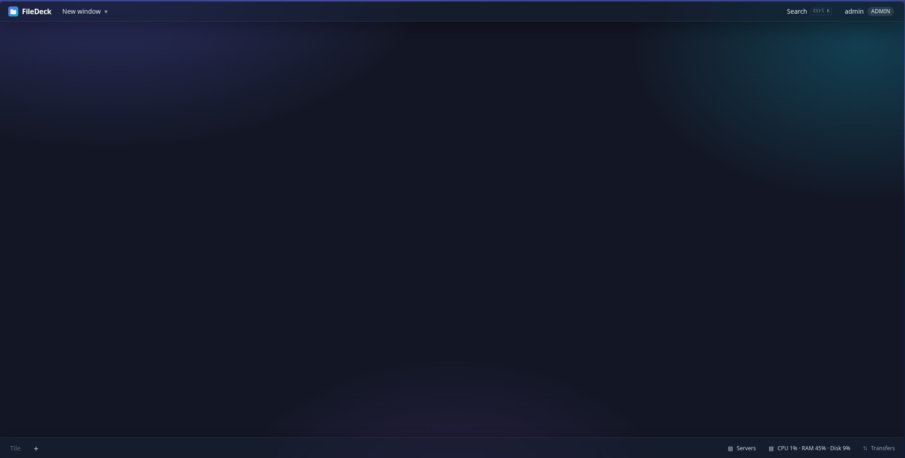
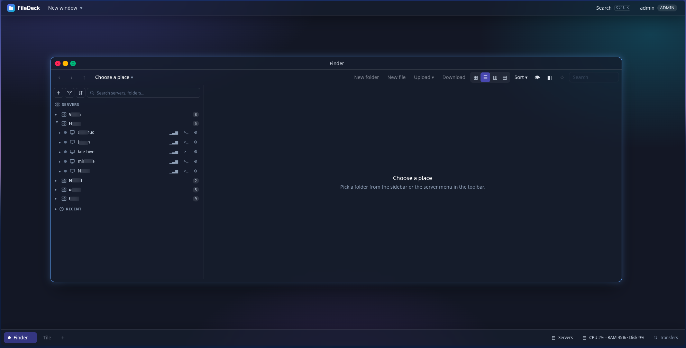
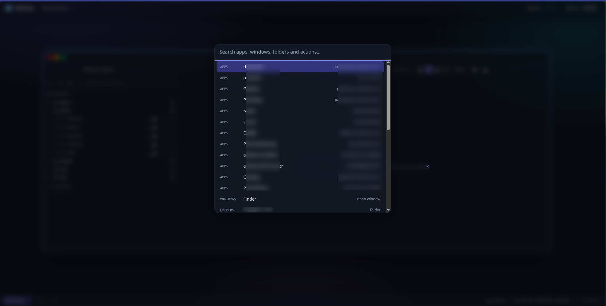
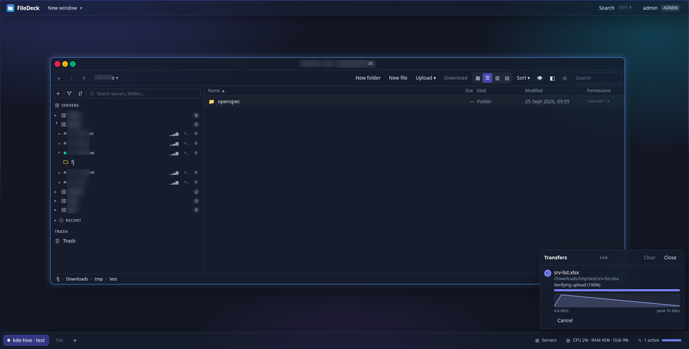
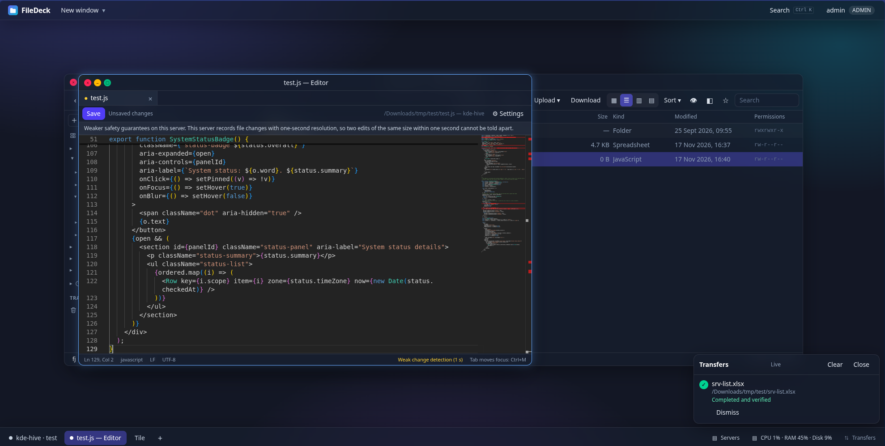

<div align="center">

# FileDeck

**Every server you own, on one desktop, in your browser.**

A self-hosted file manager with real windows, safe transfers, a conflict-proof editor, a terminal and live monitoring.
Local folders and SFTP servers side by side, with your data's integrity first.

[Quick start](#quick-start) · [Features](#what-you-get) · [Security](#built-to-be-trusted) · [HTTPS](#https) · [Backups](#backups) · [Updating](#updating)



</div>

---

## Why FileDeck

You have a NAS, a few VPSs, a homelab, maybe a jump host in front of the interesting ones. Moving files between them means
juggling SFTP clients, scp one-liners and terminals, and hoping a half-finished copy did not quietly corrupt something.

FileDeck puts all of it behind one login, on a desktop you can arrange however you like, and it **verifies** what it writes.

Priorities, in this order: **data integrity, security, filesystem correctness, transfer reliability, usability.**

## What you get

### A desktop, not a page of links
Open as many windows as you want: Finder, editor, terminal, monitor. Drag files between windows to copy or move, snap and tile
windows, minimize a terminal and it stays connected. The layout is remembered. Light, dark or follow the system.



* **Finder** with Icon, List, Column and Gallery views. Folders with 10,000 entries stay responsive.
* Create, rename, duplicate, copy, move and delete with conflict handling, a recoverable **Trash**, filename search and safe previews.
* **Ctrl/Cmd+K** command palette over apps, windows, folders and actions, and a Servers menu to jump straight to any server.



### Transfers you can trust
Big files, flaky Wi-Fi, a closed laptop lid: transfers resume.



* **Resumable chunked uploads** of very large files, hashed in the browser, staged durably, then verified again at the destination.
* **Range-resumable downloads** with a checksum *Verify* step, and streamed ZIPs.
* **Copy and move between servers.** A move deletes the source only after everything is verified.
* Live progress, pause / resume / cancel / retry, a speed graph, and resume after a page reload.

### An editor that never loses someone else's work


Monaco in its own windows, with tabs from different servers side by side. Every save is checked against the version you opened,
written to a temp file, read back and verified, and only then committed. On a conflict you can compare, reload, save as a copy or
overwrite (audited). A lost connection never shows a false "saved".

### Terminal and monitoring, over the SSH you already have


* **Terminal:** a real shell on any SFTP server in its own window. Off by default per server, granted per user, credentials stay on
  the server, and each session is audited (who, where, how long) without ever recording what you typed.
* **Monitor:** live CPU, memory, disk, network and processes for any SFTP server, with nothing installed on it.
* **Host health** (opt-in): the FileDeck host's own CPU, memory and disks in the bottom bar.


### Built for real server fleets


* Add servers in the browser with **host-key confirmation and pinning**, group them in the sidebar, and give them a DNS-name label.
* **Jump hosts:** servers reachable only through another server work in the Finder, editor, terminal and monitor.
* **MFA-protected servers:** never contacted until you click Connect, with approval prompts shown right where you are.
* **Launcher** for your web apps, with shared ones published by admins. Apps open without sending any FileDeck credentials.
* A **Servers** table for admins to set groups, routes and who is enabled, all in one place.

## Built to be trusted

* **Credentials are encrypted** on the server and never sent to the browser. The one exception is the admin-only Wallet: it asks for
  your password again, locks after a minute, reveals one secret at a time and is audited.
* **Per-root permissions** (RBAC) and an **audit log** of what happened and who did it.
* The container runs as a non-root user with no capabilities and `no-new-privileges`.
* Only the web port is published. PostgreSQL is reachable only inside the Compose network.
* Terminal sessions end the moment access ends.

## Quick start

You need Docker with Compose. The image is published on GitHub Container Registry, so nothing is built locally.

```bash
# 1. Download compose-github.yaml from this repository into an empty folder, then in that folder:
docker run --rm ghcr.io/phreak1979/filedeck:latest init-secrets > .env    # generates the secrets

# 2. Edit .env: set PUBLIC_URL to the exact address you will type in the browser

# 3. Start it
docker compose -f compose-github.yaml up -d
```

Open `http://127.0.0.1:8088` (or your `PUBLIC_URL`) and sign in as `admin`. The password is the `BOOTSTRAP_ADMIN_PASSWORD` line in
`.env`. FileDeck never prints it in its logs. Change it after the first login.

Prefer not to use `init-secrets`? Copy `env.github.example` to `.env` and fill in the required values. The file explains each one.

### Your files

* **Local folders** can only live under `/mnt` inside the container. The compose file mounts `FILEDECK_DATA_DIR` (default `./data/files`)
  at `/mnt/data`. Mount more host folders with extra `volumes:` lines, then add them as folders in the app.
* **SFTP servers** are added in the browser. FileDeck shows the host key and asks you to confirm it before it will connect.
* **Host health** is optional: uncomment the read-only `/proc`, `/sys` and disk mounts in the compose file and set
  `HOST_HEALTH_ENABLED=true` in `.env`.

### HTTPS

FileDeck listens on `127.0.0.1:8088` by default. Put a TLS reverse proxy in front of it. With Nginx Proxy Manager:

1. Add a **Proxy Host** for your domain, scheme `http`, forwarding to the Docker host on port `8088`. Turn on *Websockets Support*,
   a Let's Encrypt certificate, *Force SSL* and *HSTS*. Turn *Cache Assets* off.
2. Set `PUBLIC_URL=https://your.domain` in `.env`, exactly as people type it. It drives the origin checks.
3. In the proxy's **Advanced** tab (needed for uploads, downloads and live updates):
   ```nginx
   client_max_body_size 33m;          # one upload chunk is at most 32 MiB; editor saves are at most 20 MiB
   proxy_request_buffering off;       # stream chunks through
   proxy_buffering off;               # downloads, ZIPs and the live-update stream must not be buffered
   proxy_read_timeout 1h;
   proxy_send_timeout 1h;
   ```
4. For internet exposure, prefer a VPN or an IP allow-list. A file manager is a high-value target.

### Backups

Back up three things, and keep the keys apart from the database:

| What | How |
|---|---|
| Database (users, audit, encrypted credentials) | `docker compose -f compose-github.yaml exec -T postgres pg_dump -U filedeck -Fc filedeck > filedeck.dump` |
| `CREDENTIAL_KEYS` from `.env` | Copy it to a password manager or an offline store. **Without it, stored SFTP credentials cannot be recovered.** |
| `.env` and `compose-github.yaml` | Your configuration |

Uploads in flight are staged in a disposable volume. Your files live on the folders and servers themselves, so back those up
separately. Try a restore now and then; an untested backup is a hope, not a backup.

### Lost admin password

The first admin is created only when the database has no users, so changing `BOOTSTRAP_ADMIN_PASSWORD` later does nothing. To set a new
password:

```bash
docker compose -f compose-github.yaml exec filedeck node reset-password.mjs admin
```

It prints a generated password once, turns the account on again, ends its sessions and records the reset in the audit log.

## Updating

```bash
docker compose -f compose-github.yaml pull && docker compose -f compose-github.yaml up -d
```

Database migrations apply automatically on start. Take a backup first. If any of the three processes inside the container stops, the
container stops, so `restart: unless-stopped` brings them all back together.

Pin a version instead of `latest` by changing the image line in the compose file, for example `ghcr.io/phreak1979/filedeck:0.11.9`.
